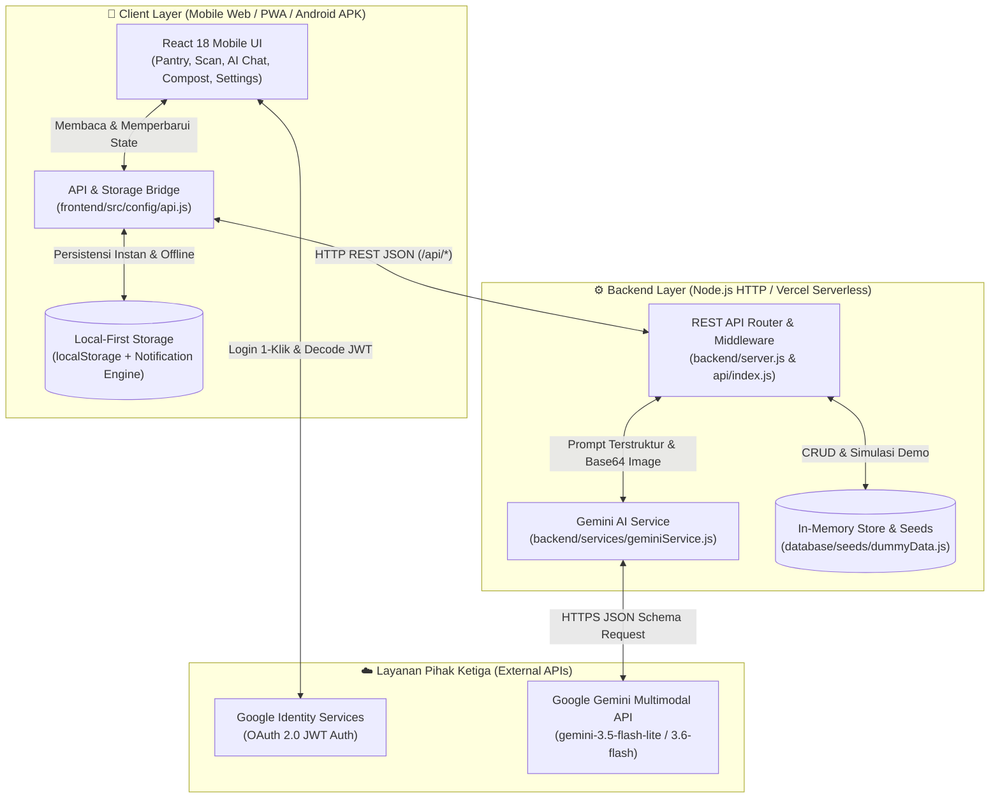
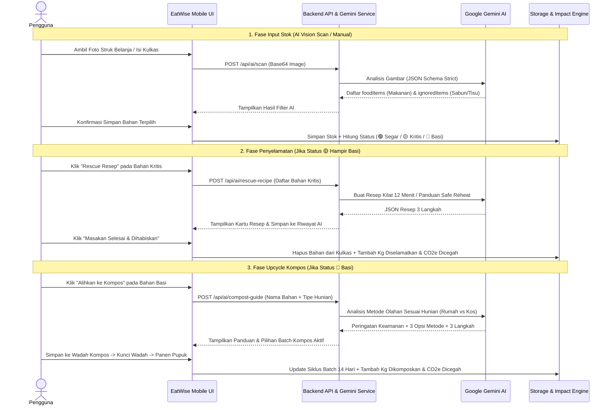

# 🌱 EatWise (SiklusPangan)
**The Closed-Loop Food Management & Smart Upcycle AI**

Aplikasi *mobile web* pintar berbasis *Multimodal Generative AI* yang membantu rumah tangga dan anak kos mengelola stok bahan makanan di kulkas, menyelamatkan bahan yang hampir kedaluwarsa dengan resep kilat, serta mengolah sisa makanan yang sudah basi menjadi kompos atau *eco-enzyme* bernilai guna sesuai kondisi hunian.

---

## 👥 1. Identitas Tim & Daftar Anggota

* **Nama Tim:** Terserah (EatWise)
* **Daftar Anggota:**
  1. **Gurveender Jeet Kaur** — *Backend Engineer*
  2. **Kamila Anisa** — *Frontend Engineer*
  3. **Rizky Laksmitha** — *Frontend Engineer*
  4. **Siti Nur Azizah** — *UI/UX Designer*


---

## 📱 2. Informasi Umum Aplikasi

* **Nama Aplikasi:** **EatWise** (*SiklusPangan*)
* **Kategori:** **Mobile** (*Mobile Web Application / PWA & Android APK Ready* — Dirancang spesifik untuk rasio layar smartphone `390×844 px` / `402×874 px`)

### Masalah yang Diangkat (*Problem Statement*)
1. **Lupa Stok Bahan & Masakan Sisa:** Banyak penghuni rumah tangga maupun anak kos membeli bahan makanan atau menyimpan sisa masakan di kulkas, namun lupa memantaunya hingga membusuk di sudut kulkas.
2. **Pencatatan Struk Belanja yang Merepotkan:** Struk belanja minimarket/supermarket mencampur bahan pangan (sayur, telur, susu) dengan barang non-pangan (sabun, deterjen, tisu, kantong plastik), sehingga pengguna malas mencatat stok secara manual.
3. **Solusi Eksisting Berujung Buntu (*Dead-End Solution*):** Aplikasi pengingat kedaluwarsa konvensional hanya memberi tahu *"makananmu sudah basi, buang saja"*. Akibatnya, sampah organik tetap berakhir di TPA dan menghasilkan gas metana serta emisi karbon ($\text{CO}_2\text{e}$) berbahaya.

### Deskripsi Solusi (*Closed-Loop System*)
**EatWise** menghadirkan ekosistem pengelolaan pangan **siklus tertutup (*closed-loop*)** dari hulu ke hilir:
* **Hulu (Input Instan dengan AI Filter):** Pengguna cukup memotret struk belanja atau isi kulkas. **Gemini Vision AI** secara otomatis mendeteksi dan merapikan nama bahan makanan, memperkirakan masa simpan (*expiry days*), serta mencoret/mengabaikan produk non-makanan (sabun, tisu, deterjen).
* **Tengah (Penyelamatan Sebelum Basi):** Sistem *Smart Pantry* mengelompokkan bahan ke dalam 3 status warna (🟢 **Segar**, 🟡 **Hampir Basi / Kritis**, 🔴 **Basi / Lewat Waktu**). Untuk bahan berstatus kuning, fitur **AI Rescue Recipe** menyusun resep masakan kilat (5–15 menit) atau panduan menghangatkan ulang (*safe reheat*) untuk masakan sisa.
* **Hilir (Upcycle Saat Terlanjur Rusak):** Untuk bahan berstatus merah/basi, aplikasi memberikan peringatan keamanan pangan dan mengarahkannya ke **AI Compost & Smart Upcycle Guide**. AI memberikan 3 opsi pengolahan organik yang disesuaikan dengan tipe hunian pengguna (*Rumah dengan Halaman* vs *Kos/Apartemen* bebas bau seperti *Eco-Enzyme*, *Bokashi*, atau *Takakura*), lengkap dengan manajemen wadah kompos (*Smart Batch*) 14 hari hingga panen pupuk organik.

### Target Pengguna
1. **Rumah Tangga & Keluarga:** Yang rutin berbelanja mingguan/bulanan dan ingin menghemat pengeluaran dapur sekaligus memproduksi pupuk organik untuk tanaman rumah.
2. **Mahasiswa / Anak Kos & Penghuni Apartemen:** Yang sering menyimpan stok makanan cepat saji/masakan sisa dan membutuhkan panduan pengolahan limbah organik **tanpa bau** di ruang sempit.
3. **Individu Peduli Lingkungan (*Zero-Waste Enthusiast*):** Yang ingin memantau dampak nyata pengurangan limbah pangan (kg makanan diselamatkan & kg emisi $\text{CO}_2\text{e}$ yang berhasil dicegah).

---

## ✨ 3. Daftar Fitur Utama yang Berhasil Diimplementasikan

1. **Autentikasi Google OAuth 2.0 & Mode Demo Instan:**
   * Integrasi resmi *Google Identity Services (GIS)* untuk login 1-klik menggunakan akun Google.
   * Dilengkapi *Fallback Demo Login* otomatis agar juri/penguji dapat langsung masuk tanpa terkendala konfigurasi domain OAuth.
2. **Smart Pantry Dashboard & Kalkulator Dampak Lingkungan (*Green Impact*):**
   * Visualisasi stok kulkas dengan indikator masa simpan real-time (🟢 Segar, 🟡 Hampir Basi $\le 2$ hari, 🔴 Basi $0$ hari), pencarian cepat, pengurutan prioritas, dan filter kategori.
   * Perhitungan otomatis **Kg Makanan Diselamatkan**, **Kg Sisa Pangan Dikomposkan**, dan **Kg Emisi $\text{CO}_2\text{e}$ Dicegah** ($1\text{ kg pangan} \approx 2.5\text{ kg CO}_2\text{e}$).
3. **AI Vision Scan Struk Belanja & Foto Kulkas:**
   * Pengambilan foto langsung dari kamera perangkat atau unggah gambar galeri.
   * Pemisahan cerdas antara **Bahan Makanan Terdeteksi** (otomatis terpilih dengan estimasi hari simpan & lokasi penyimpanan *Chiller/Freezer/Ruang*) dan **Item Non-Makanan yang Diabaikan** (sabun, deterjen, tisu).
4. **Pencatatan Stok Manual Dual-Mode (Bahan Mentah & Masakan Sisa):**
   * Form khusus untuk **Bahan Mentah** (sayur, lauk hewani/nabati, bahan pokok, camilan) dan **Masakan Sisa (*Leftover*)** lengkap dengan pencatatan waktu masak serta pengingat batas konsumsi aman.
5. **AI Rescue Recipe (Resep Penyelamat Bahan Kritis):**
   * Menyusun resep praktis 3 langkah berdurasi 5–15 menit dari kombinasi bahan yang hampir kedaluwarsa di kulkas.
   * Membedakan penanganan antara **Bahan Mentah** (resep masak kilat) dan **Masakan Sisa / Matang** (panduan *safe reheat* atau kreasi ulang tanpa memasak dari mentah).
   * Tombol konfirmasi *"Masakan Selesai & Dihabiskan"* yang otomatis mengurangi stok kulkas dan menambah metrik penyelamatan pangan.
6. **AI Adaptive Compost Guide & Smart Batch Selection:**
   * Memberikan peringatan etika keamanan pangan (*"Makanan berlendir/basi dilarang dikonsumsi"*).
   * Menyediakan 3 opsi metode pengolahan organik yang beradaptasi dengan profil hunian:
     * **Rumah dengan Halaman:** Kompos Tanah / Biopori, Pupuk Organik Cair (POC), Eco-Enzyme.
     * **Kos / Apartemen:** Eco-Enzyme Botol Tertutup, Bokashi Kedap Udara, atau Drop-off Bank Sampah/Maggot (bebas bau menyengat).
   * **Logika Toggle Wadah Pintar (*Smart Batch*):** Mengarahkan sampah baru ke batch yang sedang dalam *Fase Pengisian*, atau otomatis mengunci pilihan jika batch sedang dalam *Fase Pematangan*.
7. **Siklus Kompos 3 Fase, Simulasi Juri (Fast-Forward 14 Hari), & Riwayat Panen:**
   * Pelacakan siklus batch kompos mulai dari **Fase Pengisian** $\rightarrow$ **Kunci Wadah (Fase Pematangan 14 Hari)** $\rightarrow$ **Siap Panen**.
   * **Tombol Simulasi Demo (*Lompat 14 Hari*):** Memudahkan juri menguji alur pematangan hingga panen pupuk secara instan tanpa menunggu 14 hari kalender.
   * Pencatatan berat hasil panen pupuk organik (kg) beserta panduan pemakaian dan penyimpanan pupuk.
8. **Asisten Tanya AI (*Guardrailed Zero-Waste Chat*) & Riwayat Konsultasi:**
   * Konsultasi terarah satu-ketukan (*one-shot auto-prompt*) untuk topik penyelamatan bahan hampir basi dan pengolahan kompos, dilengkapi penyimpanan riwayat percakapan.
9. **Notifikasi Cerdas & Pengingat Harian Terjadwal:**
   * Pusat notifikasi otomatis untuk bahan kritis, bahan kedaluwarsa, dan batch kompos siap panen, dilengkapi efek suara notifikasi (*Web Audio API*) serta pengaturan jam pengingat harian.

---

## 🛠️ 4. Teknologi yang Digunakan

| Lapisan | Teknologi / Library | Kegunaan |
| :--- | :--- | :--- |
| **Frontend Framework** | React 18.3 (`react`, `react-dom`) + Vite 5.4 | Rendering antarmuka *mobile-first* reaktif dan *bundling* cepat |
| **Styling & UI** | Tailwind CSS 3.4, PostCSS, Autoprefixer, Lucide React, Canvas Confetti | Desain komponen presisi sesuai Figma, ikonografi, dan mikro-interaksi selebrasi |
| **Backend Runtime** | Node.js Native HTTP Server (`backend/server.js`) & Vercel Serverless (`api/index.js`) | Penyedia 19 endpoint REST API untuk AI proxy, autentikasi, pantry, dan kompos |
| **Database & Storage** | Hybrid Storage (`localStorage` Engine + SQL Relational Schema di `database/schema.sql`) | Penyimpanan *local-first* yang instan, menjaga privasi perangkat, dan tahan *cold-start* serverless |
| **Kecerdasan Buatan (AI)** | Google Gemini API (`@google/generative-ai` / REST `v1beta`) | Multimodal Vision OCR struk/makanan, generator resep penyelamat, & analisis kompos adaptif |
| **Autentikasi** | Google Identity Services (OAuth 2.0) + `jwt-decode` | Dekode kredensial JWT Google Sign-In & manajemen sesi profil pengguna |
| **Testing & Dokumentasi** | Node.js Native Test Runner (`node:test`) + Postman Collection (`docs/postman_collection.json`) | Pengujian unit otomatis (*offline-capable*) dan dokumentasi kontrak API |

---

## 📂 5. Struktur Susunan Folder Fullstack

Proyek ini disusun mengikuti arsitektur **Fullstack Modular** yang memisahkan lapisan `frontend/`, `backend/`, `database/`, dan `docs/` secara rapi:

```text
siklus-pangan/
├── frontend/                        # Lapisan Antarmuka Pengguna (React + Tailwind CSS)
│   ├── public/
│   │   └── manifest.json            # Web App Manifest untuk PWA & pembungkusan APK Android
│   └── src/
│       ├── assets/figma/            # Aset ilustrasi & ikon SVG/PNG hasil ekspor desain Figma
│       ├── config/
│       │   └── api.js               # Unified API Client & jembatan sinkronisasi penyimpanan
│       ├── features/                # Modul halaman berbasis fitur (Feature-Based Architecture)
│       │   ├── ai-assistant/        # AskAiPage, AiHistoryPage, RescueRecipeModal
│       │   ├── auth/                # SplashScreen, LoginScreen (Google OAuth), LogoutDialog
│       │   ├── compost/             # CompostCyclePage, CompostGuideModal
│       │   ├── pantry/              # PantryDashboardPage, NotificationPage, AiScanModal, ManualStockModal
│       │   └── settings/            # SettingsPage (Preferensi Hunian & Jam Notifikasi)
│       ├── shared/components/       # Komponen lintas halaman (TopHeader, BottomNavBar, BrandLogo)
│       ├── App.jsx                  # Orkestrasi navigasi mobile frame & state global
│       ├── index.css                # Konfigurasi dasar Tailwind & tipografi
│       └── main.jsx                 # Entrypoint aplikasi React
├── backend/                         # Lapisan Server REST API & Logika Layanan Bisnis
│   ├── controllers/                 # Ekspor handler & orkestrasi kontroler API
│   ├── middleware/
│   │   └── httpMiddleware.js        # Middleware CORS, serialisasi JSON, & body parser
│   ├── models/
│   │   └── dbModel.js               # Inisialisasi state data & skema model in-memory
│   ├── routes/
│   │   └── apiRoutes.js             # Definisi kontrak rute REST API
│   ├── services/
│   │   ├── geminiService.js         # Integrasi multimodal Google Gemini AI & rotasi model
│   │   └── storageService.js        # Engine persistensi data, kalkulasi CO2e, & penjadwalan notifikasi
│   ├── tests/
│   │   └── backend.test.js          # Suite unit test otomatis (Node.js test runner)
│   └── server.js                    # HTTP Server utama (Port 3001) & request router
├── database/                        # Lapisan Skema Database, Migrasi, & Seed Data
│   ├── migrations/
│   │   └── 001_initial_schema.sql   # Skrip migrasi inisialisasi tabel
│   ├── seeds/
│   │   ├── dummyData.js             # Data seed JavaScript deterministik untuk simulasi & API
│   │   └── seed.sql                 # Data seed SQL untuk pengujian relasional
│   ├── schema.sql                   # Definisi DDL tabel (users, food_items, compost_batches, dll.)
│   └── README.md                    # Dokumentasi skema & arsitektur penyimpanan hybrid
├── docs/                            # Dokumentasi Proyek & Koleksi Pengujian API
│   ├── postman_collection.json      # Koleksi 19 endpoint REST API untuk pengujian di Postman
│   └── README.md                    # Dokumentasi spesifikasi layar UI/UX & arsitektur
├── api/
│   └── index.js                     # Serverless Function Entrypoint untuk deployment Vercel
├── .env.example                     # Template variabel lingkungan (Environment Variables)
├── .gitignore                       # Daftar pengecualian file Git
├── index.html                       # Dokumen root HTML & pemuat skrip Google Identity Services
├── package.json                     # Konfigurasi dependensi & skrip npm
├── postcss.config.js                # Konfigurasi PostCSS
├── tailwind.config.js               # Konfigurasi tema & palet warna Tailwind CSS
├── vercel.json                      # Aturan routing deployment Vercel
├── vite.config.js                   # Konfigurasi bundler Vite & proxy `/api`
└── README.md                        # Dokumentasi utama proyek
```

---

## 🏗️ 6. Diagram Arsitektur Sistem dan Alur Data

### A. Diagram Arsitektur Sistem



### B. Diagram Alur Data (*Closed-Loop Data Flow*)



---

## 🚀 7. Panduan Instalasi, Konfigurasi, dan Menjalankan Aplikasi

### Prasyarat Sistem
* **Node.js** versi `18.x` atau `20.x+` (disarankan LTS)
* **npm** versi `9.x+`
* Browser modern (Chrome, Edge, Safari, atau Firefox)

### Langkah 1: Clone Repository & Instal Dependensi
```bash
git clone https://github.com/itzveen/siklus-pangan.git
cd siklus-pangan
npm install
```

### Langkah 2: Konfigurasi Variabel Lingkungan (`.env`)
Salin file `.env.example` menjadi `.env` di direktori utama:
```bash
# Linux / macOS
cp .env.example .env

# Windows PowerShell
Copy-Item .env.example .env
```

Isi variabel pada file `.env` sesuai daftar berikut:

| Nama Variabel | Sifat | Deskripsi & Cara Mendapatkan |
| :--- | :--- | :--- |
| `VITE_GEMINI_API_KEY` | Direkomendasikan | API Key Google Gemini untuk pemindaian struk dan generasi resep/kompos di sisi klien. Dapatkan gratis di [Google AI Studio](https://aistudio.google.com/). |
| `GEMINI_API_KEY` | Direkomendasikan | API Key Google Gemini untuk endpoint REST API backend (`/api/ai/*`). Nilainya sama dengan `VITE_GEMINI_API_KEY`. |
| `VITE_GOOGLE_CLIENT_ID` | Opsional | Client ID OAuth 2.0 dari [Google Cloud Console](https://console.cloud.google.com/apis/credentials) untuk tombol login Google asli. **Jika dikosongkan**, tombol login tetap berfungsi menggunakan **Mode Akun Demo 1-Klik**. |
| `PORT` | Opsional | Port server HTTP backend lokal (default: `3001`). |
| `VITE_API_BASE_URL` | Opsional | Base URL endpoint API (default: `/api`). |

> **Catatan Kemudahan Pengujian:** Apabila penguji belum memasukkan `GEMINI_API_KEY` atau kuota API sedang penuh, aplikasi memiliki mekanisme **Smart Deterministic Fallback** sehingga seluruh alur *Scan Struk*, *Rescue Resep*, dan *Panduan Kompos* tetap berjalan mulus tanpa error.

### Langkah 3: Menjalankan Aplikasi Secara Lokal
Buka dua terminal (atau jalankan secara paralel):

1. **Terminal 1 — Jalankan Backend REST API (Port 3001):**
   ```bash
   npm run api
   ```
2. **Terminal 2 — Jalankan Frontend Vite Dev Server (Port 5173):**
   ```bash
   npm run dev
   ```
3. Buka browser dan akses: **`http://localhost:5173`**

### Langkah 4: Menjalankan Pengujian Unit (*Unit Tests*)
Untuk memverifikasi logika penyimpanan, kalkulasi dampak lingkungan, siklus kompos 14 hari, dan pengaturan profil secara *offline*:
```bash
npm test
```

### Langkah 5: Konfigurasi Tambahan untuk Fitur Spesifik
* **Fitur Kamera & Scan Struk:** Saat membuka modal **Scan Bahan**, izinkan akses kamera (*Allow Camera Permission*) pada browser, atau gunakan tombol **Galeri** untuk mengunggah gambar struk belanja dari perangkat.
* **Fitur Notifikasi Browser & Suara:** Saat mengubah **Jam Notifikasi** di halaman *Pengaturan*, izinkan *Browser Notification Permission* agar pengingat harian tampil sebagai notifikasi sistem disertai nada pengingat.
* **Konfigurasi Google OAuth Asli (Opsional):** Jika ingin menguji pop-up Google Sign-In menggunakan `VITE_GOOGLE_CLIENT_ID` milik sendiri, tambahkan `http://localhost:5173` pada bagian *Authorized JavaScript origins* di Google Cloud Console.

---

## 🧪 8. Akun Demonstrasi & Panduan Simulasi Juri

Aplikasi ini dirancang agar dewan juri dapat langsung menguji seluruh fitur **tanpa perlu membuat akun baru atau mengonfigurasi kredensial rumit**:

### 1. Login Akun Demonstrasi (1-Klik)
* Pada layar **Login**, cukup klik tombol **`Masuk dengan Google`**.
* Jika tidak ada sesi Google OAuth eksternal yang aktif, sistem otomatis masuk menggunakan **Akun Demonstrasi**:
  * **Nama Pengguna:** `Budi Santoso`
  * **Email Demo:** `budi@gmail.com`
  * **Preferensi Awal:** `Rumah dengan Halaman` (dapat diubah kapan saja ke `Kos / Apartemen` di tab **Pengaturan**).

### 2. Fitur Khusus Simulasi Demo Juri
* **Simulasi Scan Struk Instan:** Di layar **Scan Bahan**, Anda dapat langsung memotret gambar contoh yang tampil di viewfinder untuk melihat bagaimana AI memisahkan 3 bahan makanan (*Telur Ayam, Bayam Segar, Tomat Merah*) dan mencoret 3 barang non-makanan (*Sabun Sunlight, Tisu Paseo, Deterjen Rinso*).
* **Tombol Fast-Forward Kompos 14 Hari:** Setelah menambahkan bahan basi ke wadah kompos dan menekan **`Kunci Wadah & Mulai Pematangan`** di tab **Kompos**, tekan tombol **`Simulasi Demo: Lompat 14 Hari`** untuk langsung melompati masa fermentasi 14 hari dan menguji fitur **Catat Hasil Panen Pupuk**.
* **Reset / Seed Data Demo via API:** Untuk mengisi ulang atau mengosongkan data backend melalui Postman/cURL:
  ```bash
  # Reset ke kondisi data demo lengkap
  curl -X POST http://localhost:3001/api/reset?demo=true

  # Reset ke kondisi kulkas kosong (Fresh User State)
  curl -X POST http://localhost:3001/api/reset
  ```

---

## 🤖 9. Dokumentasi Penggunaan AI

**EatWise** mengintegrasikan **Google Gemini Multimodal AI** melalui `backend/services/geminiService.js` dan `backend/server.js`.

### 1. Arsitektur Model & Rotasi Fallback Otomatis
Untuk menjaga kecepatan respons (*low latency*) dan ketahanan terhadap batas kuota (*rate limit* `HTTP 429` / `503`), sistem menerapkan **Multi-Model Auto-Rotation** dengan batas waktu (*timeout*) ketat per model:
1. `gemini-3.5-flash-lite` (Prioritas utama — latensi tercepat untuk interaksi mobile)
2. `gemini-3.6-flash` (Cadangan pertama untuk penalaran multimodal)
3. `gemini-3.1-flash-lite` (Cadangan kedua)
4. `gemini-3.8-flash` (Cadangan ketiga untuk ekstraksi kompleks)

### 2. Tiga Kapabilitas AI Utama dalam Aplikasi
1. **Multimodal Vision OCR & Kategorisasi Produk (`/api/ai/scan`):**
   * **Input:** Citra struk belanja atau foto bahan makanan (`image/jpeg` / `image/png` dalam Base64).
   * **Tugas AI:** Mengekstrak teks struk yang disingkat (misal `"S/ROTI KRIM KEJU 72G"` $\rightarrow$ `"Sari Roti Krim Keju (72g)"`), menentukan kategori pangan (`vegetable`, `meat`, `plant_protein`, `carb`, `spice`, `snack`, `leftover`), mengonversi berat ke satuan kilogram desimal (`weightKg`), mengestimasi masa simpan (`expiryDays`), serta memisahkan produk non-makanan ke dalam `ignoredItems` (`PLASTIK`, `SABUN`, `SANITASI`, `LAUNDRY`).
2. **Contextual Rescue Recipe Generator (`/api/ai/rescue-recipe`):**
   * **Input:** Daftar bahan makanan di kulkas yang berstatus `warning` (hampir basi) beserta jenis stoknya (`raw` vs `leftover`).
   * **Tugas AI:** Menghasilkan 1 resep penyelamat berdurasi 5–15 menit dalam 3 langkah ringkas. Jika bahan berstatus *Masakan Sisa (Sudah Matang)*, AI diinstruksikan memberikan panduan penghangatan ulang yang aman (*safe reheat* / *remix*) dan dilarang menyuruh memasak ulang dari mentah.
3. **Adaptive Compost & Upcycle Analyzer (`/api/ai/compost-guide`):**
   * **Input:** Nama bahan makanan yang sudah basi (`spoiled`) dan tipe hunian pengguna (`house` vs `apartment`).
   * **Tugas AI:** Menganalisis kandungan organik bahan dan memberikan 3 opsi metode pengolahan (`alternativeOptions`) yang sesuai dengan hunian pengguna (bebas bau untuk penghuni kos/apartemen), disertai langkah pengolahan praktis dan peringatan keamanan pangan.

### 3. Guardrails, Etika, & Keamanan AI
* **Strict JSON Output (`responseMimeType: "application/json"`):** Seluruh respons model dipaksa mengikuti skema JSON terstruktur dan divalidasi dengan parser aman (`safeJsonParse`) serta normalisasi satuan berat (`normalizeWeightKg`).
* **Peringatan Keamanan Pangan (*Food Safety Guardrail*):** Bahan yang sudah berstatus `spoiled` (basi/berlendir) dikunci dari fitur resep masakan dan wajib menampilkan banner peringatan: *"Makanan berlendir/basi dilarang dikonsumsi. Alihkan ke pengolahan non-pangan."*
* **Pembatasan Konteks Percakapan (*Topic-Locked One-Shot Prompting*):** Halaman **Tanya AI** menggunakan *auto-sent structured prompt* khusus topik penyelamatan pangan & kompos untuk mencegah penyalahgunaan prompt (*prompt injection*) di luar konteks aplikasi.

---

## 📜 10. Atribusi Template, Aset, Dataset, dan Kode Pihak Ketiga

Seluruh kode sumber aplikasi ini dikembangkan oleh **Tim SiklusPangan (EatWise)** dengan memanfaatkan pustaka *open-source*, layanan, dan aset berikut:

1. **Framework & Library Open-Source:**
   * [React](https://react.dev/) & [React DOM](https://react.dev/) (MIT License)
   * [Vite](https://vitejs.dev/) (MIT License)
   * [Tailwind CSS](https://tailwindcss.com/) (MIT License)
   * [Lucide React](https://lucide.dev/) — Ikon antarmuka pendukung (ISC License)
   * [canvas-confetti](https://github.com/catdad/canvas-confetti) — Animasi konfeti saat bahan berhasil diselamatkan (ISC License)
   * [jwt-decode](https://github.com/auth0/jwt-decode) — Dekode token JWT Google OAuth (MIT License)
   * [@google/generative-ai](https://www.npmjs.com/package/@google/generative-ai) — SDK resmi Google Gemini AI (Apache-2.0 License)
2. **Desain UI/UX, Ikon, & Tipografi:**
   * Desain antarmuka *mobile-first* dan aset vektor (`frontend/src/assets/figma/*`) dirancang secara orisinal di Figma oleh tim desain EatWise.
   * Font menggunakan **Poppins**, **Plus Jakarta Sans**, dan **Manrope** dari [Google Fonts](https://fonts.google.com/) (Open Font License).
3. **Dataset & Data Simulasi:**
   * Data awal pada `database/seeds/dummyData.js` dan `database/seeds/seed.sql` merupakan **data simulasi fiktif deterministik** yang disusun khusus untuk mendemonstrasikan skenario pengguna rumah tangga/anak kos pada kompetisi.
4. **Referensi Struktur Teknis:**
   * Standar pengujian unit mandiri (*offline test runner*) dan dokumentasi mengadaptasi praktik terbaik dari repositori demonstrasi mentoring LogiCodix ([`chmdznr/logicodix-agentic-demo`](https://github.com/chmdznr/logicodix-agentic-demo)).
